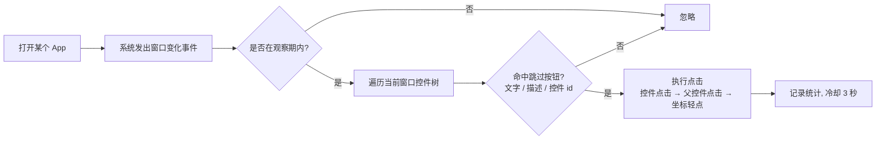

# 开屏跳过（AdSkipper）

一个用于**自动点击 Android 应用开屏广告「跳过」按钮**的工具型 App。纯 Kotlin、零第三方依赖、**不需要 Root**、**不申请联网权限**。

> 当前工作区没有安装 JDK 与 Android SDK，因此这里交付的是**完整可编译的源码工程**，以及一条**云端一键出包**流程，不含现成的 APK。按下面的任意一种方式即可生成安装包。

---

## 一、它是怎么工作的

借助系统公开的「无障碍服务（AccessibilityService）」，由用户在系统设置中主动授权：



识别线索有三条：控件文字（如「跳过广告 5s」「Skip」）、`contentDescription`、控件资源 id（含 `skip` / `ad_close` 等）。
为降低误触，代码里设了五道闸门：

1. 只处理 `TYPE_WINDOW_STATE_CHANGED` / `TYPE_WINDOW_CONTENT_CHANGED` 两类事件；
2. 内容变化只在**窗口切换后 8 秒**的观察期内处理，且最多每 250ms 扫一次；
3. 同一 App 成功点击后 **3 秒内不重复点击**；
4. 文本必须短于 18 字，且不含「同意 / 授权 / 支付 / 密码 / 允许」等敏感词；
5. 本应用、系统界面、系统设置以及用户白名单直接跳过。

---

## 二、拿到 APK 的三种方式

### 环境要求

| 项目 | 版本 |
| --- | --- |
| Android Studio | Ladybug / Meerkat 或更新（自带 JDK 17） |
| Android SDK | Platform 35、Build Tools 35.0.0 |
| Gradle | 8.9 |
| 手机系统 | Android 7.0（API 24）及以上 |

### 方式 1：Android Studio（推荐，最快）

1. `File → Open`，选择本 `AdSkipper` 目录；
2. 首次 Sync 时 IDE 会提示缺少 Gradle Wrapper，选择**自动生成**即可（目录里已给出 `gradle/wrapper/gradle-wrapper.properties`，Gradle 版本锁定为 8.9）；
3. 手机开启 USB 调试并连接电脑，点工具栏 **Run**，即可直接安装到手机；
4. 或者 `Build → Build APK(s)`，产物在 `app/build/outputs/apk/debug/app-debug.apk`。

### 方式 2：本地命令行

需自行安装 JDK 17、Gradle 8.9、Android SDK，并设置 `ANDROID_HOME`（或在 `local.properties` 中写 `sdk.dir=...`）：

```bash
gradle wrapper --gradle-version 8.9 --distribution-type bin   # 生成 wrapper（含 gradle-wrapper.jar）
./gradlew assembleDebug          # Windows 用 gradlew.bat assembleDebug
```

产物同样是 `app/build/outputs/apk/debug/app-debug.apk`，可直接安装（debug 包自带签名）。

### 方式 3：GitHub Actions 云编译（不需要本地装任何环境）

`.github/workflows/build.yml` 已配好。把本目录内容推到 GitHub 仓库后：

1. 仓库 → **Actions** → 选择「构建 APK」→ **Run workflow**（推送代码也会自动触发）；
2. 等待约几分钟，运行完成后在 **Artifacts** 下载 `AdSkipper-debug`；
3. 解压得到 `app-debug.apk`，传到手机安装即可。

---

## 三、手机上的安装与授权

1. 安装 APK，打开「开屏跳过」；
2. 点 **开启无障碍服务**，在系统无障碍列表里找到「开屏跳过」并开启；返回 App 后状态会变为「运行中」；
3. **Android 13 及以上**：若开关是灰的或提示「受限设置」，先进 `系统设置 → 应用管理 → 开屏跳过 → 右上角菜单 → 允许受限设置`，再回来开启；
4. 建议顺手完成：点 App 里的「电池优化设置」把本应用设为「不优化」，并在系统的自启动白名单、多任务列表中锁定，避免国产 ROM 冻结服务；
5. 打开任意带开屏广告的 App 验证。回到主界面，「最近一次跳过」会显示包名与时间，统计数字也会增加。

关闭系统里的无障碍开关，App 就完全停用；也可以在 App 内直接关掉「启用自动跳过」。

---

## 四、设置项说明

| 设置 | 作用 |
| --- | --- |
| 启用自动跳过 | 总开关，不影响无障碍授权状态 |
| 坐标点击兜底 | 跳过按钮是自定义绘制、既不可点击也无 id 时，改用坐标轻点；误触敏感就关掉 |
| 跳过时显示提示 | 每次成功点击弹一个短 Toast，便于调试，默认关闭 |
| 跳过关键词 | 每行一条（也支持中英文逗号分隔），改完点「保存规则」立即生效 |
| 应用白名单 | 填应用包名，这些 App 完全不扫描。遇到误触优先用这个 |
| 运行统计 | 累计 / 今日跳过次数、最近一次跳过的包名与时间，可清零 |

**查包名的方法**：`adb shell dumpsys window | grep mCurrentFocus`（Windows 用 `findstr`），或在系统「应用信息」页查看，也可以用任意「包名查看器」类工具。

**某些 App 不生效怎么办**：开屏广告的跳过控件可能既没有文字也没有规范 id。可先开启坐标兜底；进阶做法是在 `AdMatcher.findSkipNode()` 中按「包名 + 控件 id / 坐标区域」写专用规则，这是同类工具后续迭代的常规方向。

---

## 五、常见问题

| 现象 | 处理 |
| --- | --- |
| 状态一直显示「未开启」 | 回到 App 刷新（onResume 会自动重查）；确认开的是「开屏跳过」而不是同名设置项 |
| Android 13+ 无法开启 | 先「允许受限设置」，见上文第 3 步 |
| 用一阵子失效 | 无障碍服务被系统冻结，配置电池优化白名单 / 自启动 / 多任务锁定，必要时重新开关一次无障碍 |
| 出现误触 | 把该 App 加入白名单，或关闭坐标兜底、删掉过宽泛的关键词 |
| 统计一直为 0 | 说明没命中按钮；打开「跳过时显示提示」和坐标兜底再试，检查该 App 的跳过按钮文案并补进关键词 |
| 有些开屏广告没有跳过按钮 | 属于 App 自身设计，工具无法跳过；只能等广告本身结束 |

---

## 六、隐私与使用边界

- **不联网**：Manifest 中刻意不声明 `INTERNET` 权限，代码里也没有任何网络调用；
- **不采集**：规则、白名单、统计只写在本机 `SharedPreferences`，且已通过备份规则排除，不参与系统备份；
- **不越界**：不读取通知 / 短信 / 剪贴板，不注入或修改其他应用，不需要 Root，所有动作等价于用户自己点了一下「跳过」；
- **请合理使用**：本项目仅供个人设备自用与学习研究，请勿用于绕过付费 / 会员内容，也不建议商业分发（同类工具曾在应用市场遇到过第三方平台的下架要求）。广告是许多免费 App 的收入来源，喜欢某个应用的话，购买会员去广告是更体面的选择。

---

## 七、目录结构

```
AdSkipper/
├── build.gradle.kts                  # 顶层插件版本（AGP 8.7.3 / Kotlin 2.0.21）
├── settings.gradle.kts               # 仓库与模块
├── gradle/wrapper/gradle-wrapper.properties
├── .github/workflows/build.yml       # 云端出包
└── app/
    ├── build.gradle.kts              # compileSdk 35 / minSdk 24 / targetSdk 34，零第三方依赖
    └── src/main/
        ├── AndroidManifest.xml
        ├── java/com/adskipper/app/
        │   ├── MainActivity.kt       # 设置界面与授权引导
        │   ├── SkipAdService.kt      # 无障碍服务：事件监听、限流、点击
        │   ├── AdMatcher.kt          # 跳过按钮识别规则
        │   └── AppConfig.kt          # 配置、白名单、统计（SharedPreferences）
        └── res/
            ├── layout/activity_main.xml
            ├── xml/accessibility_service_config.xml
            ├── values/                # 颜色、主题、字符串
            └── drawable/              # 卡片、按钮、图标（全 vector，无二进制资源）
```

想调整识别策略，优先改 `AdMatcher.kt`（规则）与 `SkipAdService.kt`（时机与点击方式）这两个文件。
